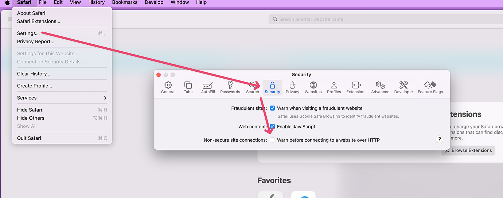
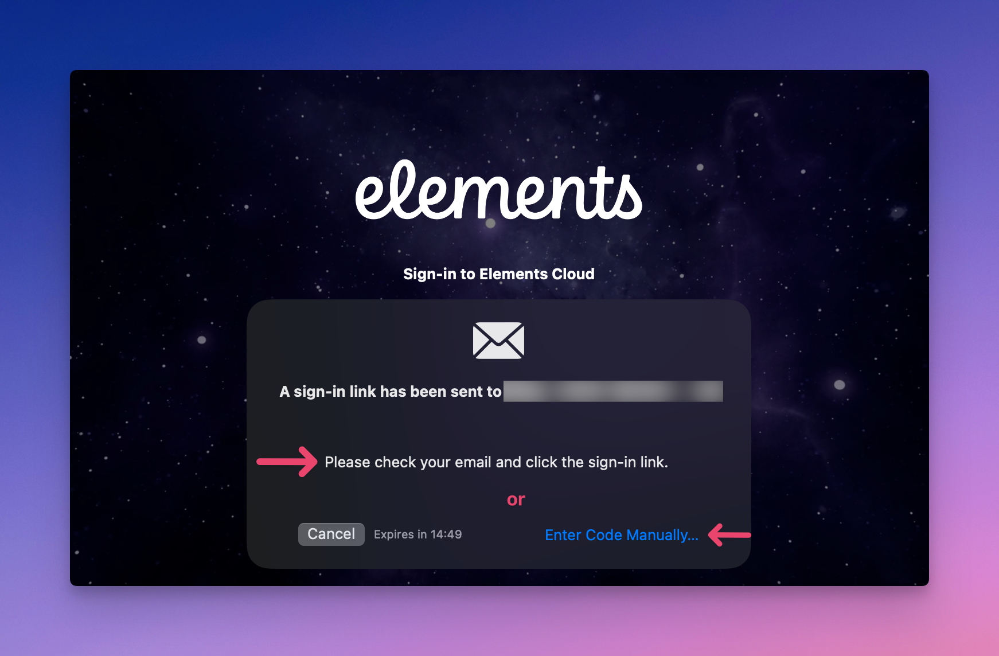
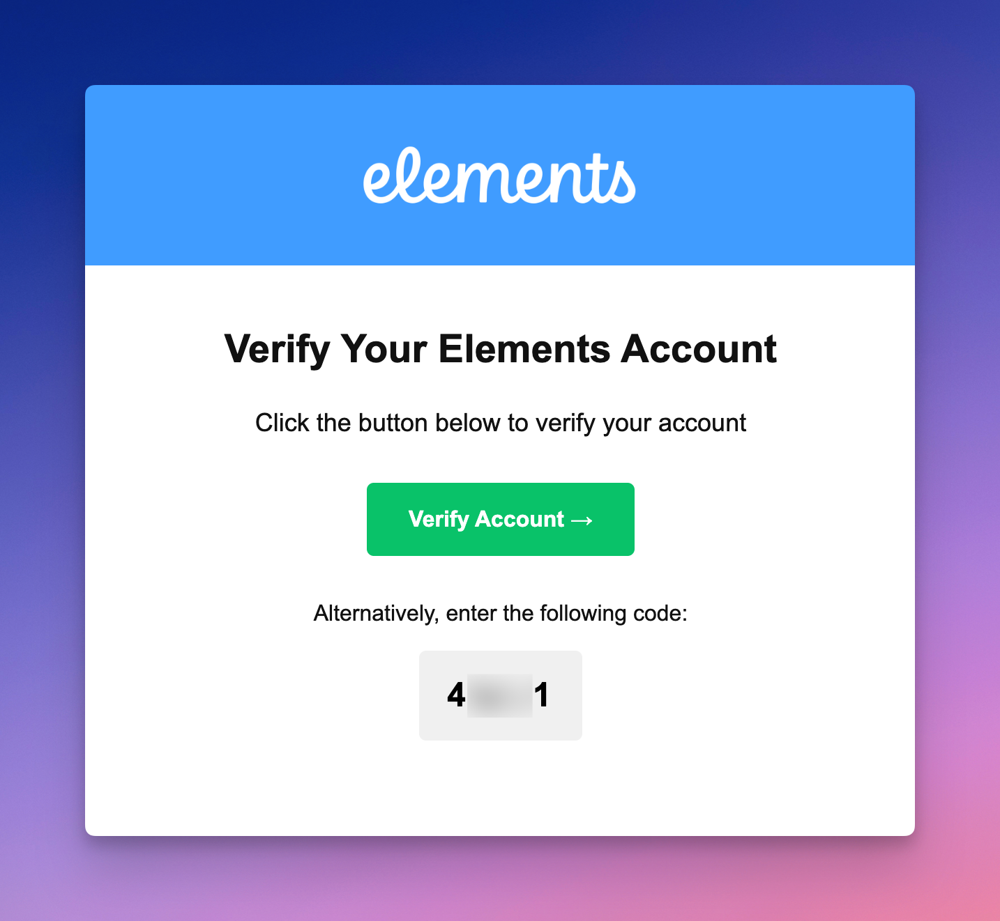
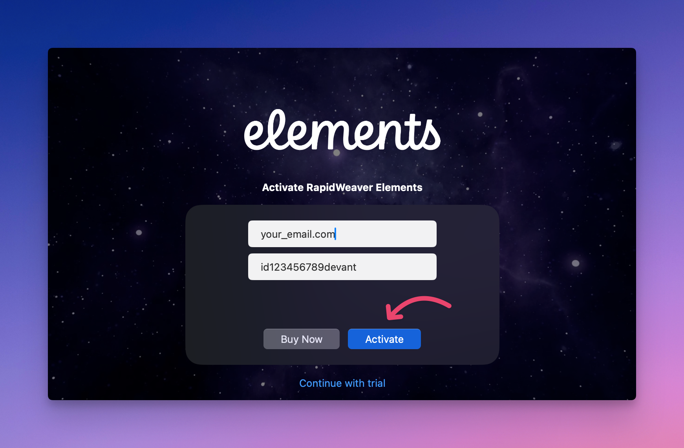
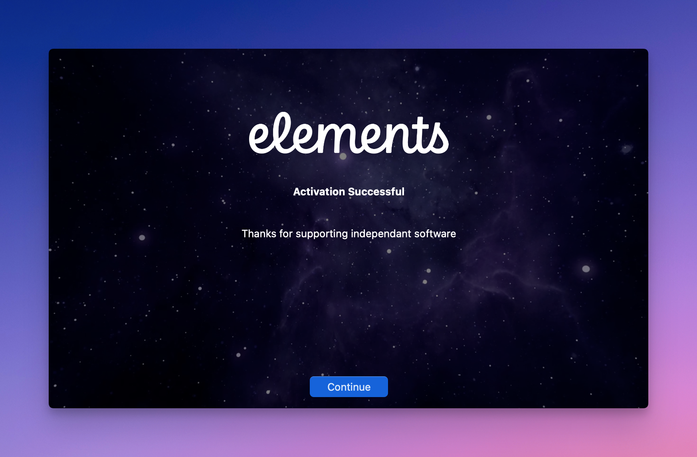

# FAQ

Welcome to the official FAQ for RapidWeaver Elements. This resource is designed to provide you with clear and concise answers to the most common questions.

Whether you’re just getting started or you’re an experienced user, our goal is to make sure you have all the information you need to build stunning websites with confidence.


Questions about buying, licences, subscriptions, refunds and billing are answered in the [Buying and billing FAQ](https://docs.realmacsoftware.com/buying-and-billing), which covers every Realmac app.



If your question is not answered below, please [post on our Community Support Forum](https://forums.realmacsoftware.com/). We aim to reply within 48 hours, although it is often much sooner.


### General Questions

What are the system requirements for Elements?

To run Elements, your Mac must meet the following requirements:

* macOS 13.7.8 (**Ventura**), macOS 14 (**Sonoma**), macOS 15 (**Sequoia**), or macOS 26 (**Tahoe**).
* Apple silicon (M1, M2, M3, M4 or M5) or an Intel-based processor.

Do you offer a trial version of Elements?

**Yes!** You can download a free trial of Elements from our [website](https://realmacsoftware.com/rapidweaver/).

What are the trial limitations?

The trial mode in Elements has the following limitations:

* No publishing: You can’t upload or publish sites in trial mode.
* No export: Exporting project files is disabled.
* Maximum of 3 pages: You can only add up to three pages per project.

Where can I purchase Elements?

You can [purchase Elements via our website](https://realmacsoftware.com/pricing/).

I still have a question, where can I go for help?

If your question was not answered above or you need clarification, [post on the Elements forum](https://forums.realmacsoftware.com/c/rapidweaver-elements/43). Following our [Support Guide](getting-started/troubleshooting/) will help the community resolve your issue more quickly.

### Editor Issues

Error when trying to preview in Safari

If you are seeing a "Safari Can't Open the Page" error, you'll need to disable the "Warn before connecting to a Website over HTTP" option in the Safari Security settings.

<figure><figcaption></figcaption></figure>

How can I make a file (PDF, ZIP, audio, etc.) available for download on my website?

You can do this easily by adding a link to some text, a button, or whichever element you want. When setting the link, select the file from your resources and add a custom attribute called `download`. This attribute will prompt the browser to download the file, not open it.

<figure><figcaption></figcaption></figure>

### Pre-Sales Questions

For trials, refunds and how buying works, see [Pre-sales](https://docs.realmacsoftware.com/buying-and-billing/pre-sales).

What are the differences between the Base, Plus, and Pro licenses?

Elements offers three license options: Base, Plus and Pro. Choose the plan that best fits your needs, whether you are a casual user, hobbyist, professional web designer or part of a team.

Every Elements license includes everything you need to build a website, but there are a few key differences. See [License Types](getting-started/license-types.md) for details.

### Licensing Questions

Lost licence, missing licence email or an activation error? See [Licensing](https://docs.realmacsoftware.com/buying-and-billing/licensing).

How many Macs can I use my Elements license on?

Each Elements license allows activation on a maximum of three Macs simultaneously.

How do I activate my license?

When you open Elements for the first time, a welcome screen appears. Click **Continue**.

Next, create an Elements Cloud account. Enter your email address and click **Send Sign-in Link**.

<figure><figcaption></figcaption></figure>

You will receive a sign-in link from **noreply@elementsapp.cloud**. If it is not in your inbox, check your spam folder. Click **Verify Account** in the email, or enter the code manually.

<figure><figcaption></figcaption></figure>

<figure><figcaption></figcaption></figure>

Next, activate your Elements license. The license key is in the email you received after completing your purchase.

Enter the email address used for the purchase and your Elements license key, then click **Activate**.

<figure><figcaption></figcaption></figure>

Elements is now activated and ready to use.

<figure><figcaption></figcaption></figure>

How do I deactivate my license?

If you have access to the activated copy of Elements:

1. Open your registered copy of Elements.
2. Choose **Elements → Registration…**
3. Click **Deactivate** under **Activations (1 of X)**.
4. Confirm your decision.

You can now use the same license to register the app on another Mac.

If you do not have access to your old Mac, you can still manage activations in the **Registration** window. Choose **Elements → Registration…** to view and deactivate registered Macs.

### Subscription Questions

For renewals, cancelling and what happens when your updates end, see [Subscriptions](https://docs.realmacsoftware.com/buying-and-billing/subscriptions).

Can I switch to a different plan?

Yes. You can upgrade or downgrade at any time from the **Subscription** tab in Elements Settings.

<figure><figcaption></figcaption></figure>

### Billing Questions

Order history, invoices, payment details and changing your email address are covered in [Billing](https://docs.realmacsoftware.com/buying-and-billing/billing).
